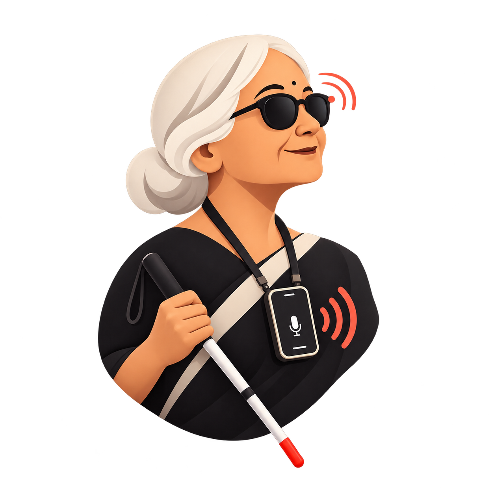

<p align="center">
  
</p>

# An Offline-First AI Assistant for Blind Users, Built on Gemma 3n

An accessibility-first AI vision assistant for blind and visually impaired users. The app combines on-device vision, OCR, voice input, streaming text-to-speech, and an agentic decision system to answer questions about the user's surroundings.

*Team VedX (Yugal Kishor and Harshvardhan Singh) | neatlogs Hackathon*

## Links

- Website: [blindvisionassistant.vercel.app](https://blindvisionassistant.vercel.app)
- Release assets: [GitHub Release](https://github.com/yugalkishor-agi/Blind-Vision-Assistant/releases/tag/release)

## Why we built this

AI has come a long way, but most powerful assistants still depend on a constant internet connection and are designed as general-purpose chatbots rather than accessibility tools. For a blind user, that creates two serious problems: the internet may be unreliable exactly when help is needed, and sending personal photos to a remote service can be a privacy risk.

We wanted to build something that could help with real daily tasks such as navigation, shopping, reading labels, and understanding surroundings—without making the user fight through a complicated interface. The goal was not just to make an AI demo. The goal was to make an assistant that a blind person could actually use.

The app is offline-first: on a compatible phone, the model and vision processing run locally. Remote mode is included as a practical fallback for emulator demos and devices that cannot run the local model comfortably.

## What the app does

Blind Vision Assistant helps users:

- Understand rooms, objects, people, colors, obstacles, and surroundings.
- Read signs, labels, menus, prices, expiry dates, and other visible text.
- Ask general knowledge and conversational questions without opening the camera.
- Use voice dictation instead of typing.
- Hear AI responses through streaming text-to-speech while the answer is being generated.
- Control common actions with a Bluetooth keyboard/controller such as the 8BitDo Micro.

The main vision workflow captures a single image when needed, processes it, and closes the camera immediately. The app does not keep a continuous camera preview running.

## The idea behind the experience

The app is designed around a simple interaction: ask a question, get useful guidance, and hear the answer without needing to look at the screen. A user can tap the large controls, dictate a question, or use a small Bluetooth controller. Audio cues communicate when dictation starts, when a message is sent, and when the assistant is still working.

This project was shaped by testing with my brother, who is completely blind with no light perception. His feedback made the difference between a feature that looked good in a demo and one that was genuinely usable. It pushed us to keep the experience on one screen, make controls explicit for TalkBack and VoiceOver, and treat latency and audio feedback as core product problems rather than small details.

## Agentic vision workflow

The app includes an agentic loop that chooses the right tool for each request instead of always sending every query through the camera.

```text
User question
     │
     ▼
Text-only decision step
     │
     ├── final_answer  → answer from general knowledge, no camera
     ├── ask_user      → ask the user to clarify
     ├── run_ocr       → capture image → ML Kit OCR → grounded answer
     ├── detect_scene  → capture image → Gemma vision → scene answer
     └── analyze_both  → capture image → OCR + Gemma vision
```

### How the decision is made

1. The user's query is first sent to Gemma without an image.
2. Gemma is asked to return a small JSON decision containing an allowed action and a reason.
3. The app validates that action against a strict allowlist.
4. The camera is opened only when the selected action requires an image.
5. The selected tool runs with timeouts and limited retries.
6. OCR output is treated as grounded text when available, reducing text hallucinations.
7. The final answer is streamed to the UI and to the text-to-speech service.

If Gemma does not return valid JSON, the app retries with a stricter prompt and then uses a deterministic keyword-based fallback. This keeps the app useful even when the model does not follow the decision format perfectly.

The important design choice is that the agent does not capture an image for every question. A question such as “What is the capital of France?” can be answered without opening the camera. A question about a label or a scene gets the right visual tool. This reduces camera overhead, improves privacy, and makes the interaction feel much faster.

## From camera experiments to the phone camera

We considered putting an IP camera in a hat and also experimented with an ESP32-CAM. Both approaches created practical problems: battery life, camera quality, setup complexity, and unreliable access from the app. Most importantly, the images were not consistently good enough for reading text.

We chose the phone's camera because a phone powerful enough to run Gemma 3n usually has a much better camera, and it avoids extra hardware and pairing steps. The phone can be mounted in a chest harness so the user's hands remain available for a cane or controller. Since a blind user does not need a live preview, the app captures a quick snapshot and closes the camera before inference begins.

That decision also solved a major performance bottleneck. Keeping the camera preview open made inference roughly ten times slower in our testing. Removing the continuous preview reduced a simple response from roughly 50 seconds to around 5 seconds on the tested setup.

## The controller and accessibility details

Touch is not always practical when a phone is mounted or when a user is walking. We therefore support a Bluetooth keyboard/controller such as the 8BitDo Micro. Its buttons can be configured as F1–F10, with each key mapped to a useful action: start or stop dictation, send text with a photo, send text only, ask “What is this?”, open settings, or activate the focused control.

We also designed the screen for users who do use a phone directly. Controls have large readable labels instead of relying only on icons, and TalkBack/VoiceOver receives explicit descriptions. When accessibility services interrupt TTS, the app tracks the spoken position and can retry the response instead of getting stuck in a speaking state.

## Why OCR is a separate tool

Reading printed text is one of the most important use cases, and visual-language models can hallucinate text even from a clear photo. Google ML Kit OCR runs locally and is usually much faster and more reliable for extracting text. The agent can route a request to OCR, then pass the grounded text to Gemma so the final answer is based on what was actually detected.

## Core technology

- **Framework:** Flutter / Dart
- **On-device vision model:** Gemma 3n E2B IT Int4 through `flutter_gemma`
- **OCR:** Google ML Kit Text Recognition
- **Voice input:** `speech_to_text`
- **Text-to-speech:** `flutter_tts`
- **Camera:** Flutter Camera plugin
- **Audio feedback:** `audioplayers`
- **Model download:** `flutter_downloader`
- **Model authentication:** Hugging Face OAuth with PKCE
- **Local settings:** `shared_preferences`
- **Optional remote backend:** OpenAI-compatible Gemma server through a Cloudflare Tunnel

## Project structure

```text
lib/
├── main.dart                         App bootstrap and routing
├── chat_page/
│   ├── agent/                         Agent decisions and vision tools
│   ├── config/                        Prompt templates
│   ├── handlers/                      Keyboard/controller shortcuts
│   ├── models/                        Chat message models
│   ├── services/                      Gemma, OCR, speech, TTS, camera helpers
│   └── widgets/                       Prompt bar, chat bubbles, accessible UI
├── download_page/
│   ├── logic/                         Model download coordinator
│   ├── models/                        Download state and enums
│   ├── services/                      OAuth, downloader, persistence, logging
│   └── ui/                            Download screen widgets
├── error_recovery_page.dart           Model failure recovery
└── settings_page.dart                 Backend, prompt, and controller settings
```

## Running locally

### Requirements

- Flutter SDK
- Android Studio or an Android device/emulator
- A compatible device for practical on-device Gemma inference

### Setup

```bash
flutter pub get
flutter analyze
flutter test
flutter run
```

The first on-device run may require downloading the Gemma model. The model is large, so keep the app open during the download and use a stable internet connection.

## Emulator and remote model mode

The local Gemma model may not run reliably inside an emulator because of memory, hardware acceleration, and vision-inference limitations. The repository release includes a Kaggle notebook for remote testing.

1. Open the provided notebook in Kaggle.
2. Add a Hugging Face token as a Kaggle Secret named `HF_TOKEN`.
3. Run the notebook to start the Gemma-compatible model server.
4. Start a Cloudflare Tunnel and copy its HTTPS URL.
5. Install and open the APK.
6. Open `Settings` and enable `Remote Model`.
7. Paste the Cloudflare Tunnel URL and save.

The app will use the remote server for Gemma requests instead of the local model. This is mainly intended for emulator/demo testing.

> Never hardcode `HF_TOKEN` or any API key in the notebook or source code. Use Kaggle Secrets or another secure secret store.

> Remote mode sends prompts and captured images to the configured server. Use on-device mode when local processing and maximum privacy are required.

## Accessibility and interaction

- Large text-based controls with explicit screen-reader labels.
- Voice input button for dictation.
- Streaming response speech for reduced waiting time.
- Audio cues for dictation, sending, loading, and completion states.
- Keyboard/controller shortcuts for users who cannot comfortably use the touchscreen.
- A single-screen interaction model to reduce navigation effort.

The controller can be configured to send function keys such as F1–F10. These actions can start dictation, send a prompt with a photo, send text only, trigger common vision questions, open settings, or activate the focused control.

## Release assets

The GitHub release contains:

- `app-debug.apk` — APK for testing.
- `sourcecode.zip` — Clean source-code package.
- Kaggle notebook — Remote Gemma setup for emulator testing.

Download them from the [release page](https://github.com/yugalkishor-agi/Blind-Vision-Assistant/releases/tag/release).

## Privacy and limitations

- On-device mode keeps images and inference on the device.
- The on-device model requires several gigabytes of storage and suitable hardware.
- Emulator performance may be insufficient for local vision inference.
- Remote mode depends on the Kaggle server and Cloudflare Tunnel remaining available.
- The app processes captured snapshots rather than a continuous live video stream.
- Poor network conditions can interrupt the initial model download.

## Final thoughts

This project came down to one idea: a blind user should be able to ask for help in a normal situation without depending on a complicated screen or handing every photo to a third party. The agentic loop, local OCR, snapshot-based camera flow, streaming speech, and controller support all serve that same goal.

## Team

**Team VedX**
Yugal Kishor and Harshvardhan Singh

Built for the neatlogs Hackathon.
